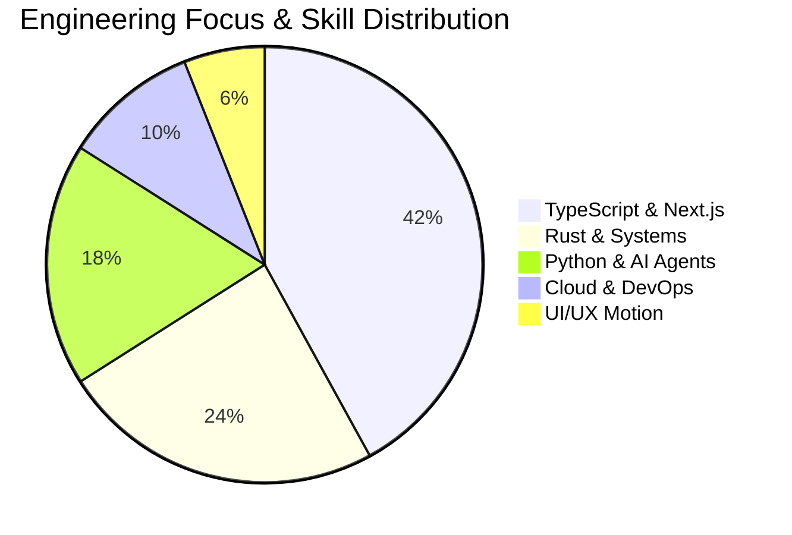

<div align="center" id="top">

  <a href="https://github.com/yuvrajlaptop2008-byte/readmeforge">
    <picture>
      <source media="(prefers-color-scheme: dark)" srcset="https://raw.githubusercontent.com/yuvrajlaptop2008-byte/readmeforge/main/public/logo-dark.svg">
      <source media="(prefers-color-scheme: light)" srcset="https://raw.githubusercontent.com/yuvrajlaptop2008-byte/readmeforge/main/public/logo-light.svg">
      
    </picture>
  </a>

  <br />

  <p align="center">
    
  </p>

  <p>
    <strong>The next-generation profile README generator, personalized visual studio, and dynamic animation suite.</strong><br />
    Craft a unique, non-generic GitHub profile tailored specifically to your engineering discipline. Features animated roaming characters, interactive domain personalization, dynamic pie/donut charts, annual commit activity graphs, 6-step visual wizard, Monaco <code>/developer</code> IDE, 10+ modular widgets, confirmation-gated resume parsing, and direct GitHub synchronization.
  </p>

  <p>
    <a href="https://github.com/yuvrajlaptop2008-byte/readmeforge/actions/workflows/ci.yml">
      
    </a>
    <a href="https://nextjs.org">
      
    </a>
    <a href="https://www.typescriptlang.org">
      
    </a>
    <a href="https://vitest.dev">
      
    </a>
    <a href="https://biomejs.dev">
      
    </a>
    <a href="https://github.com/yuvrajlaptop2008-byte/readmeforge/blob/main/LICENSE.md">
      
    </a>
  </p>

  <p>
    <a href="#quickstart-1-line-install">Quickstart</a> &bull;
    <a href="#roaming-ai-chatbot--animated-characters">Roaming Characters</a> &bull;
    <a href="#developer-mode-monaco-ide--live-sync">/developer Mode</a> &bull;
    <a href="#personalized-profiles-never-the-same">Personalization</a> &bull;
    <a href="#dynamic-graphs--pie-charts">Charts & Graphs</a> &bull;
    <a href="#touch-motion--haptic-effects">Touch & Motion</a> &bull;
    <a href="#live-visual-showcase--dynamic-widgets">Live Widgets</a> &bull;
    <a href="#animation-studio--motion-toolkit">Animation Studio</a> &bull;
    <a href="#docker--local-setup">Docker & Setup</a>
  </p>

</div>

---

## Roaming AI Chatbot & Animated Characters

Watch the ReadmeForge animated assistant in action! Features a floating AI chatbot roaming back and forth with hovering thrusters and cycling status thoughts, paired with a walking pixel developer coding on a cyber tablet:

<div align="center">
  
</div>

<br />

---

## Quickstart: 1-Line Install

Launch ReadmeForge instantly locally, inside an autonomous AI agent, or within your favorite IDE:

| Runtime / Agent | Single-Line Command | Description |
| :--- | :--- | :--- |
| **NPX (Instant Studio)** | `npx readmeforge@latest` | Zero-install local browser launch at `http://localhost:3000` |
| **Claude Code Agent** | `claude mcp add readmeforge -- npx -y readmeforge` | Mount as native MCP tool inside Anthropic's Claude Code |
| **Google Antigravity IDE** | `agy add plugin readmeforge` | Native DeepMind agent skill for autonomous profile forging |
| **Cursor IDE** | `cursor --install-extension readmeforge` | AI-first code editor extension with live README generation |
| **VS Code** | `code --install-extension readmeforge` | Visual Studio Code extension with split-pane live markdown |
| **PNPM / CLI** | `pnpm dlx readmeforge` | Fast, lightweight package runner |
| **Linux / macOS** | `curl -fsSL https://git.new/readmeforge \| bash` | 1-line shell installer with auto-dependency setup |
| **Windows PowerShell** | `iwr -useb https://git.new/readmeforge.ps1 \| iex` | 1-line PowerShell installer |
| **Direct ZIP Download** | [Download readmeforge.zip](https://github.com/yuvrajlaptop2008-byte/readmeforge/archive/refs/heads/main.zip) | Standalone source archive for offline local dev |

<div align="center" style="margin-top: 14px;">
  <a href="https://github.com/yuvrajlaptop2008-byte/readmeforge/archive/refs/heads/main.zip">
    
  </a>
  <a href="#developer-mode-monaco-ide--live-sync">
    
  </a>
</div>

<div align="center" style="margin-top: 12px;">
  
</div>

---

## `/developer` Mode: Monaco IDE & Live Sync

For power users who prefer code over clicking, ReadmeForge features a dedicated **`/developer` mode** powered by Microsoft's Monaco Editor (`@monaco-editor/react`):

<div align="center">
  
</div>

<br />

### Key `/developer` Capabilities
- **Split-Screen Studio**: Left pane renders the full Monaco JSON editor with syntax coloring, bracket matching, and auto-completion.
- **Sub-16ms Live Sync**: Any keystroke in the Monaco editor instantly re-renders the live Markdown preview with zero perceptible delay.
- **Bi-Directional State Binding**: Switch seamlessly between the visual wizard and `/developer` mode without losing a single attribute.
- **Strict Zod Schema Validation**: Real-time validation guarantees your configuration never generates corrupted Markdown.
- **Command Palette (`Cmd+K` / `Ctrl+K`)**: Rapidly insert plugins, format JSON, or toggle dark/light preview themes.

---

## Personalized Profiles: Never The Same

Most profile generators output cookie-cutter markdown that looks identical for every engineer. **ReadmeForge features a deterministic Personalization Engine** (`src/lib/personalization/profile-generator.ts`) that tailors profile sections, visual hierarchies, color harmonies, typing lines, and data widgets to the user's authentic engineering role:

| Engineering Persona | Accent Palette & Vibe | Core Visual Focus | Dynamic Typing Headlines |
| :--- | :--- | :--- | :--- |
| **AI / Machine Learning** | Emerald (`#10B981`) & Tokyo Night | Language Pie/Donut Chart, Model Inference Heatmap, Research Bullets | Transformer Models, Multi-Agent Swarms, Distributed RAG Runtimes |
| **Cloud & DevOps SRE** | Cyan (`#06B6D4`) & Nord Ice | Platform Activity Velocity Graph, Multi-Cloud Topology Shields | Zero-Trust Meshes, Terraform IaC, Sub-Second GitOps Pipelines |
| **Full-Stack Polyglot** | Violet (`#8B5CF6`) & Radical Cyber | Languages Donut Chart, Commit Velocity Heatmap, Full-Stack Badges | TypeScript & Next.js 16, Reactive Systems, Distributed Postgres |
| **Creative & Motion Designer** | Rose (`#EC4899`) & Radical Neon | Shader Illusions, 60fps Micro-Interactions, 3D Canvas Showcase | Fluid Web Animations, Three.js & WebGL Shaders, Spatial 3D UIs |
| **Systems & Embedded Hacker** | Amber (`#F97316`) & One Dark | Memory-Safe Metrics, Bare-Metal Low-Level Stacks, SIMD Highlights | Rust & Modern C++, Bare-Metal Linux Drivers, Lock-Free Concurrency |

*Select domain presets directly inside Step 1 of the visual wizard or via `/developer` mode.*

---

## Dynamic Graphs & Pie Charts

Showcase your true engineering strengths and commit habits with interactive visual charts rendered natively in GitHub Markdown:

### 1. Top Languages Donut & Pie Charts (`pie-chart`)
Render high-contrast SVG donut and pie charts representing your GitHub language breakdown or custom skill focus:

<div align="center">
  
  &nbsp;&nbsp;
  
</div>

<br />

### 2. Native Mermaid Markdown Pie Charts (Zero External Image Requests)
ReadmeForge generates pure native Mermaid Markdown pie charts that render natively on GitHub without any external image services:



<br />

### 3. Annual Contribution Activity Graph (`activity-graph`)
Zero-downtime, high-availability SVG activity graph displaying commit velocity across the entire year:

<div align="center">
  
</div>

<br />

### 4. Dynamic Animated Contribution Snake (`snk`)
Automated vector animation of a retro arcade snake eating your contribution squares:

<div align="center">
  
</div>

---

## Touch, Motion & Haptic Effects

ReadmeForge is engineered from the ground up for tactile, physics-based responsiveness across touchscreens, trackpads, and mice:

- **Touch & Mobile Feedback**: Damped spring-press responses (`active:scale-95`), tactile border glows, and touch-scrubbed contribution grids.
- **Magnetic 3D Hover**: Specular glare highlights, dynamic elevation lift (`translateY(-4px)`), and radial cursor spotlights.
- **Scroll Dynamics**: Sticky pinned preview panel, intersection-triggered reveals, and scroll-linked timeline sequences.
- **Vestibular Accessibility**: Strict adherence to `prefers-reduced-motion`—instantly disabling disorienting parallax while preserving subtle opacity transitions.

---

## Live Visual Showcase & Dynamic Widgets

ReadmeForge brings GitHub profiles to life with dynamic internet widgets and high-resolution vector assets:

### 1. Holographic Developer Command Deck
Custom visual artwork featuring a futuristic developer workstation with floating holographic profiles, emerald heatmaps, dynamic metrics, and live data streams:

<div align="center">
  
</div>

<br />

### 2. GitHub Profile Trophies & Rank Tier System (`github-profile-trophy`)
Dynamic trophies reflecting developer milestones with metallic rank tiers (SSS, S, A+), rendered via high-availability mirror:

<div align="center">
  
</div>

<br />

### 3. Earned GitHub Achievement Badges
Showcase official achievement badges unlocked on GitHub profiles with direct links to the profile achievements tab:

<div align="center">
  <a href="https://github.com/octocat?tab=achievements">
    
    
    
    
    
    
  </a>
</div>

<br />

### 4. Live Dynamic GitHub Stats & Streak Cards
Integrated directly with verified cloud endpoints or rendered locally with zero latency:

<div align="center">
  
  
</div>

<br />

### 5. Developer Community Badges (Professional & Witty)
Vector status shields for engineering humor and workstation pride:

<div align="center">
  
</div>

---

## Animation Studio & Motion Toolkit

ReadmeForge features an enterprise-grade in-browser **Animation Studio** (`/animator`) and AI agent skill (`.agents/skills/readme-animation-studio/SKILL.md`) for crafting GitHub-compliant animated SVG banners, dynamic typography, 3D illusions, and interactive motion components:

<details open>
<summary><strong>✨ Typography, Frames & Character Effects Suite (Click to expand / collapse)</strong></summary>

<br />

- **Typography & Text Effects**:
  - `typing`: Terminal typewriter with blinking cursor.
  - `scramble`: Rapid cipher glyph flicker and matrix decryption jitter.
  - `gradient`: Continuous iridescent horizontal chrome shimmer sweep.
  - `glitch`: Chromatic aberration RGB split with horizontal slice displacement.
  - `wave`: Harmonic sinusoidal displacement wave across sequential characters.
  - `reveal`: Smooth editorial curtain expansion and vertical slide-up.

- **Animated Background Effects**:
  - `fire`: Rising heat embers and multi-stop flame curves.
  - `water`: Fluid undulating sinusoidal waves and caustic ripples.
  - `particles`: Rising luminous sparks and ambient glowing energy orbs.
  - `grids`: Perspective coordinate cyber grid with traveling scanner sweeps.
  - `stars`: Deep space multi-layer starfield with dual-frequency twinkle cycles.
  - `matrix`: Vertical streams of phosphor digital code rain.

- **Cyber Frames & Border Illuminations**:
  - `cyber-neon`: High-voltage laser chasing border with animated corner brackets.
  - `glassmorphism`: Translucent frosted glass rim with 45-degree specular reflection.
  - `terminal-crt`: Retro curved CRT monitor bezel with horizontal scanlines.
  - `hologram`: Sci-fi targeting HUD with telemetry coordinates and crosshairs.
  - `gold-metallic`: Luxurious 3D beveled metallic gold border with twinkling glints.
  - `fire-border`: Blazing perimeter frame with heat pulsation.

- **Animated Vector Characters & Actions**:
  - Characters: `pixel-dev` (hoodie & visor), `cyber-bot` (floating robot), `builder-crafter` (hardhat & vest), `ninja-coder` (headband & kunai), `wizard-mage` (wizard hat & crystal staff).
  - Actions: `walk` (patrol baseline), `build` (hammering blocks), `code` (holographic terminal), `construct` (circuit welding), `cheer` (victory jump with gold trophy).

</details>

<br />

<details>
<summary><strong>🌐 Cross-Platform Multi-Language Motion Reference Matrix (Click to expand)</strong></summary>

<br />

| Language / Platform | Recommended Libraries & Frameworks | Primary Use Cases |
| :--- | :--- | :--- |
| **JavaScript / TypeScript** | [Motion](https://motion.dev/), [GSAP](https://gsap.com/), [Anime.js](https://animejs.com/), [Three.js](https://threejs.org/) | Web micro-interactions, 3D WebGL scenes, interactive canvas |
| **HTML / CSS** | CSS `@keyframes`, Web Animations API (WAAPI), [Animate.css](https://animate.style/) | Lightweight zero-dependency transitions, portable SVG animations |
| **React / Next.js** | Motion (Framer Motion), GSAP, [shadcn/ui](https://ui.shadcn.com/), [Aceternity UI](https://ui.aceternity.com/) | Production UI components, glowing borders, smooth layout animations |
| **Vue / Svelte** | Motion, GSAP, Svelte Transitions | Reactive component transitions, spring & tween stores |
| **Python** | [Manim](https://www.manim.community/) (3Blue1Brown), [Pygame](https://www.pygame.org/), Pillow | Programmatic mathematical animations, 2D game loops, particle renderers |
| **Flutter / Dart** | [Flutter Animation APIs](https://docs.flutter.dev/ui/animations), [Rive Runtime](https://rive.app/) | Cross-platform mobile motion, interactive vector state machines |
| **React Native** | [React Native Reanimated](https://docs.swmansion.com/react-native-reanimated/), Gesture Handler | 60+ FPS native thread mobile UI gestures and physics-driven springs |
| **C# / Unity** | Unity Animator, [DOTween](http://dotween.demigiant.com/) | 3D game character kinematics, procedural UI tweening |
| **C++ / Rust** | [SFML](https://www.sfml-dev.org/), [Bevy](https://bevy.org/), [macroquad](https://macroquad.rs/) | Native desktop interfaces, high-performance game rendering loops |
| **Swift / Kotlin** | [SwiftUI Animations](https://developer.apple.com/xcode/swiftui/), Android Animation APIs | Fluid spring animations, declarative view transitions, Metal shaders |

</details>

---

## Plugin Ecosystem

Every widget in ReadmeForge is a modular, typed plugin defined in `src/lib/plugins/` adhering to strict Zod runtime schemas:

| Plugin Name | Category | Badge Preview | Description |
| :--- | :--- | :--- | :--- |
| **`pie-chart`** | Charts | `` | Dynamic Donut/Pie charts and native Mermaid Markdown skill distributions. |
| **`activity-graph`** | Velocity | `` | High-availability annual commit velocity line graphs and density heatmaps. |
| **`github-readme-stats`** | Stats | `` | Dynamic cards displaying total stars, commits, PRs, and top languages. |
| **`github-achievements`** | Badges | `` | Official earned GitHub achievement badges (Pull Shark, Quickdraw, Starstruck, Galaxy Brain). |
| **`github-profile-trophy`** | Gamification | `` | Dynamic achievement trophies reflecting your GitHub milestones and ranking. |
| **`snk` (Snake Game)** | Animation | `` | Generates an animated snake eating your GitHub contribution graph squares. |
| **`readme-typing-svg`** | Animation | `` | Animated SVG typewriter cycling through roles, quotes, or slogans. |
| **`waka-readme-stats`** | Metrics | `` | Real-time coding statistics, daily hours, and IDE language breakdowns. |
| **`markdown-badges`** | Shields | `` | Official branded icons and shields for languages, frameworks, and tools. |
| **`visitor-counter`** | Analytics | `` | Lightweight, privacy-respecting profile view counter. |
| **`portfolio-contributions`** | Showcase | `` | Formatted cards linking to pinned open-source repositories and notable PRs. |

---

## Interactive 6-Step Visual Wizard

1. **Step 1: Identity & Domain Personalization** — Set GitHub handle, display name, tagline, and select domain presets (AI/ML, DevOps, Full-Stack, Creative, Systems) to auto-tailor headlines and assets.
2. **Step 2: Style & Vibe** — Customize alignment, primary accent colors, and Shields.io badge styling (`for-the-badge`, `flat`, `flat-square`, `plastic`).
3. **Step 3: Skills & Tech Stack** — Curated library of 150+ technology shields with official brand logos, grouped by category.
4. **Step 4: Stats, Charts & Plugins** — Toggle commit stats, language donut/pie charts, annual commit velocity graphs, trophy cases, snake animations, and WakaTime hourly tracking.
5. **Step 5: Social Media & Contact Links** — Add verified shields linking to your LinkedIn, X/Twitter, portfolio, email, and Discord.
6. **Step 6: Projects & Bio Highlights** — Showcase key featured repositories, open-source highlights, and fun facts.

---

## Security & Architectural Invariants

- **Single Store Truth**: `src/store/useReadmeStore.ts` acts as the single authoritative source of truth. No desynced or diverging UI states.
- **Pure Markdown Engine**: `buildMarkdown(config)` in `src/lib/buildMarkdown.ts` is 100% deterministic, functional, and completely decoupled from React or browser DOM.
- **Zero Hallucination Guarantee**: Uploaded resumes or external profiles are strictly parsed and passed to `ConfirmGate.tsx`. Zero fields are injected into your profile without explicit review and confirmation.
- **Safe Remote Writes**: Writes to GitHub repositories require authenticated PAT validation and side-by-side diff confirmation (`DiffPreview.tsx`).
- **No Telemetry / No Tracking**: Your resume contents, tokens, and credentials remain private and are never stored on external databases.

---

## Docker & Local Setup

### Quick Commands
```bash
# Clone & install dependencies
git clone https://github.com/yuvrajlaptop2008-byte/readmeforge.git && cd readmeforge
corepack pnpm install

# Start development server with Turbopack
corepack pnpm dev

# Run verification suite (111 test files, 535 tests passing)
corepack pnpm test run && corepack pnpm type-check
```

<details>
<summary><strong>🐳 Docker Container Deployment Instructions (Click to expand)</strong></summary>

<br />

```bash
# Build standalone multi-stage Docker image
docker build -t readmeforge:latest .

# Run container on port 3000
docker run -d --name readmeforge -p 3000:3000 readmeforge:latest

# Check container logs
docker logs -f readmeforge
```

</details>

---

## Contributing

Contributions make the open-source community thrive! Follow these steps to contribute:

1. **Fork the Repository**
2. **Create a Feature Branch** (`git checkout -b feat/epic-new-widget`)
3. **Commit your Changes** following [Conventional Commits](https://www.conventionalcommits.org/):
   ```bash
   git commit -m 'feat(plugin): add leetcode-stats widget wrapper'
   ```
4. **Run Verification Suite**:
   ```bash
   corepack pnpm test run && corepack pnpm type-check
   ```
5. **Push to the Branch** (`git push origin feat/epic-new-widget`)
6. **Open a Pull Request** with a detailed summary.

---

## Star History

If ReadmeForge helped you create a standout GitHub profile, drop a star on the repo:

<div align="center">
  <a href="https://github.com/yuvrajlaptop2008-byte/readmeforge/stargazers">
    
  </a>
</div>

---

## License

Distributed under the **MIT License**. See [LICENSE.md](LICENSE.md) for complete details.  
Third-party component notices and upstream OSS attributions are documented in [THIRD_PARTY_LICENSES.md](THIRD_PARTY_LICENSES.md).

<div align="center">
  <sub>Forged with passion by the ReadmeForge open-source community.</sub>
</div>
